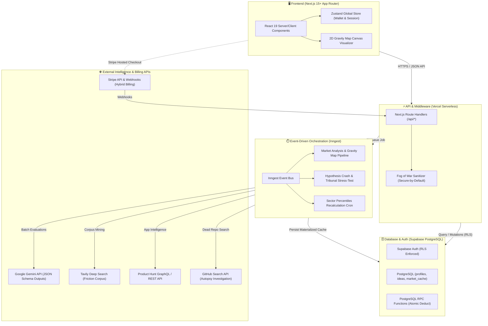
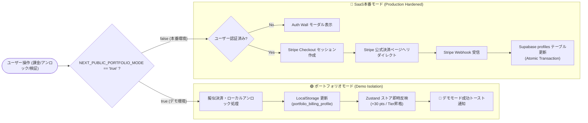
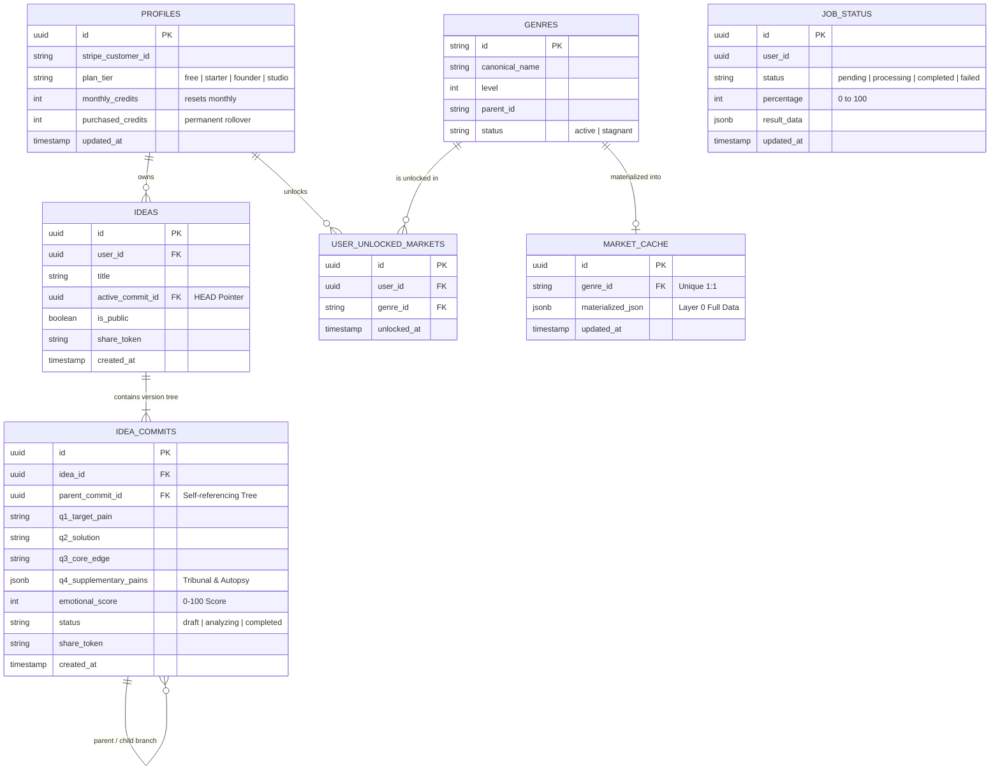

# 🛠️ The Garage - Market Gap Analysis & Idea Validation

> **「確証バイアスを破壊し、市場の『未充足の深い摩擦』から逆算してビジネスアイデアを極限検証するB2B/SaaSプロダクト創出エンジン」**

[](https://nextjs.org/)
[](https://www.typescriptlang.org/)
[](https://supabase.com/)
[](https://www.inngest.com/)
[](https://stripe.com/)
[](https://ai.google.dev/)
[](https://tailwindcss.com/)
[](https://vercel.com/)

🌐 **Live Demo (Portfolio Mode):** [https://market-gap-analysis-idea-validation.vercel.app](https://market-gap-analysis-idea-validation.vercel.app)  
*(※採用担当者・エンジニア向けに、完全ログイン不要・無料擬似決済で全機能が即座に体験できる「ポートフォリオモード」が稼働しています)*

---

## 🌍 Short English Summary

**The Garage** is an enterprise-grade B2B SaaS validation & market topology intelligence platform engineered to eradicate founders' fatal confirmation bias. By ingesting raw customer friction, Product Hunt market signals, and GitHub's graveyard of abandoned repositories (GitHub Autopsy), it models 2D multi-dimensional *Gravity Maps* and subjects product hypotheses to ruthless stress-testing via multi-persona AI tribunals. Architected with an API cost-normalized hybrid credit economy, secure-by-default data obfuscation (*Fog of War*), and an isolated, zero-friction *Portfolio Demo Mode* designed for instant evaluation.

---

## 📌 プロジェクト概要

「The Garage」は、新規事業創出やスタートアップ起業において最も致命的な失敗因である**「誰も欲しがらないものを情熱だけで作り切ってしまうこと（No Market Need = 42%のスタートアップ死因）」**を根本から排除するための仮説検証SaaSプラットフォームです。

従来の市場調査ツールが「勝者の機能リスト」や「表面的な市場規模」を報告するのに対し、The Garage は**既存プレイヤーに対する顧客の泥臭い不満（Friction）、無理な回避策（Workaround）、過去に散っていった類似プロジェクトの死因（GitHub Autopsy）**を徹底収集。重力物理学モデルに着想を得たトポロジーマップを描画し、起業家のアイデアを冷徹なAI共同創業者・審査員会によって極限まで叩き潰して（Reality Crash）、真の勝機が見えるピボットを導き出します。

---

## 💡 開発背景と解決した課題

```
【起業家が陥る従来の罠】
思いつきのアイデア ➔ 肯定的な友人・LLMの甘い称賛 ➔ 数ヶ月の開発 ➔ 誰も課金せず死亡 ➔ 理由不明の放棄

【The Garage がもたらすパラダイムシフト】
市場の摩擦・死骸から逆算 ➔ 3xペナルティ評価・冷徹なAI審査 ➔ 構造的欠陥の早期特定 ➔ 確信を持ったピボット
```

### 1. 「自分が作りたいもの症候群（確証バイアス）」の破壊
多くの生成AIやアドバイザーはユーザーのアイデアを無責任に肯定しがちです。The Garage は、**「投資家」「冷酷な競合幹部」「懐疑的な現場リーダー」**という利害の異なる3名のAIペルソナ審査員会（Tribunal）を配備。さらにGitHubのアーカイブされた放棄リポジトリを照合し、「なぜ先行者たちが死んだのか」を突きつけることでバイアスを物理的に破壊します。

### 2. 表面的な機能比較 vs 本質的な「泥臭い摩擦（Friction）」の抽出
競合のLPを見るだけでは市場の隙間（ホワイトスペース）は見えません。実務現場で発生している「Zapierで5個のツールを無理やり繋いでいる」「専任者しか操作できず属人化している」「個人クレカで会社非公認ツールを隠れて契約している」といった**構造的摩擦**をTavily検索コーパスから自動蒸留し、参入すべき「クレーター（市場の穴）」として可視化します。

### 3. LLMのハルシネーションを排除する「数理×決定論」アプローチ
「この市場は有望か」をLLMの自由テキスト生成だけに頼ると、実行のたびに回答がブレて分析の信頼性が損なわれます。The Garage では、**Bordaカウント法による数理的競合選定**、**重力物理モデル（引力スコア・押出圧力）**、**ルールベースの決定論的タグ判定**を組み合わせ、LLMの推論能力を構造化された枠組みの中に閉じ込めることで高い再現性を担保しています。

---

## 🏗️ システムアーキテクチャ

### 1. 全体システム構成図 (System Architecture)



---

### 2. SaaS本番モード vs ポートフォリオモード 切り替え概念図

本番コードを一切改ざん・汚染せず、環境変数 `NEXT_PUBLIC_PORTFOLIO_MODE` のオン/オフのみでセキュアな本番SaaSとノンストレスなデモ体験を切り替えるアーキテクチャを採用しています。



---

## ✨ 主要機能一覧

| カテゴリ | 機能名 | 提供価値・技術仕様 |
| :--- | :--- | :--- |
| **市場探索 (Discover)** | **🪐 摩擦の重力トポロジーマップ** | 市場の「押出圧力（不満度）」と「牽引力（解決力）」を独自の重力物理アルゴリズムで2D座標化。主要競合を惑星、未充足の穴をクレーターとして可視化。 |
| **市場探索 (Discover)** | **🏷️ 5つの決定論的・市場状況タグ** | LLMの気まぐれを排除した数理ルールにより、市場の健全性や参入障壁を即座に分類（`High Gravity` / `Graveyard` / `Frankenstein` / `High Cognitive Load` / `Shadow IT`）。 |
| **市場探索 (Discover)** | **🔒 戦場の霧 (Fog of War)** | 未購入ユーザーに対して、APIレベルで機微推論データを物理的に `null` 化。レイアウト用の幾何座標のみを返却し、有料データのスクレイピングを根本遮断。 |
| **仮説検証 (Validate)** | **💥 リアリティ・クラッシュ・エンジン** | 起業家のアイデア（Q1:課題〜Q4:モデル）を冷徹なAI共同創業者・審査員会（投資家・競合・現場）と衝突させ、容赦のない「KILL / PIVOT / SURVIVED」の引導を渡す。 |
| **仮説検証 (Validate)** | **☠️ GitHub 死骸報告書 (Autopsy)** | GitHub上の過去の放棄・アーカイブされた類似リポジトリを自動探索。「なぜ先行者が死んだのか」の解剖理由と星数を突きつけ、3倍のペナルティスコアを算出。 |
| **版数管理 (Git for Ideas)** | **🌳 イミュータブル系譜ツリー** | アイデアの改善履歴をGitのコミットのようにツリー管理。親コミットと子コミットの差分（Semantic Diff）を記録し、任意の過去バージョンから別世界線へピボット可能。 |
| **経済圏 (Economy)** | **⚡ ハイブリッド・ウォレット経済** | 「毎月リセットされる月次枠」と「永久繰越される買い切り枠」を共存させ、月次枠から優先消費されるSaaS型ハイブリッド課金アーキテクチャ。 |
| **UX & 認証** | **🤝 プログレッシブ・サインアップ** | ログイン不要でドラフト作成・体験を可能にし、成果物保存のタイミングでOAuth連携を促す。48h TTL付きLocalStorageからSupabaseへの完全自動データ移行。 |

---

## 🛠️ 技術スタック & 選定理由

| レイヤー | 採用技術 | 選定理由・アーキテクチャ上の意義 |
| :--- | :--- | :--- |
| **Framework** | **Next.js 15+ (App Router)** | React Server Components による初回描画の極小化と、Suspense境界による CSR Bailout（useSearchParams）の完全防止。Turbopackによる高速ビルド。 |
| **Language** | **TypeScript 5.0+** | Zod スキーマと共有したEnd-to-Endの型安全性。AIの構造化出力（JSON Schema）とフロントエンドの型同期。 |
| **Database & Auth** | **Supabase (PostgreSQL)** | 行レベルセキュリティ（RLS）によるマルチテナント保護。PostgreSQL RPC によるクレジット消費トランザクションのアトミック実行。 |
| **Job Queue** | **Inngest** | Vercelの無料枠（10秒）やPro枠（60秒）の**サーバーレスタイムアウト制限を完全回避**。ステップ分割実行、自動指数バックオフレトライ、ポーリングトラッカー連携。 |
| **LLM & Reasoning** | **Google Gemini API** | 圧倒的なコンテキストウィンドウ（10社分の摩擦コーパスを一括処理）と、JSON Schemaによる型崩れゼロの構造化出力（Structured Outputs）。 |
| **Deep Search** | **Tavily AI** | レビューサイト、Reddit、専門フォーラムのノイズを除去し、競合製品に関する純度の高い「現場の不満コーパス」を高速収集。 |
| **Billing** | **Stripe** | サブスクリプション管理と買い切り追加トークンを統合したハイブリッド課金。Webhooksによる非同期残高同期。 |
| **State Management** | **Zustand** | グローバルウォレット残高や認証状態を軽量かつ高信頼にリアクティブ同期。ポートフォリオモード時のモックストレージとの透過的連携。 |

---

## 💎 技術的な挑戦・設計上のこだわり (Portfolio Highlights)

本プロジェクトを実装するにあたり、単なる「動くWebアプリ」ではなく、**本番商用稼働に耐えうる堅牢なSaaS設計思想**を細部に宿らせています。以下にエンジニアリングおよびプロダクトマネジメント視点での主要なこだわりを詳述します。

### ① 本番コードを汚染しない「ポートフォリオモード」の隔離アーキテクチャ
* **背景と課題:**  
  本プロジェクトは本来、Stripe決済とSupabase認証が必須の本番SaaSとして構築されました。しかし、採用選考や一般公開の場で「クレジットカード入力」や「アカウント登録」を必須とすると、大半のユーザーが体験前に離脱してしまいます。一方で、デモのために本番の認証・課金ロジックをモックコードで上書きしてしまうと、商用コードとしての信頼性が失われます。
* **技術的解決策:**  
  [`lib/portfolio.ts`](file:///home/c0a241589e/dev/MarketGapAnalysis_IdeaValidation/lib/portfolio.ts) にて `isPortfolioMode()` を判定する完全隔離レイヤーを構築しました。本番用の Supabase RLS ポリシーや Stripe Webhook ハンドラーのコードは**一切改ざんせず 100% 保持**したまま、フロントエンドおよび API 側で透過的なフォールバックを実装しました。
  * **擬似決済:** Stripe Checkout へのリダイレクトを遮断し、Zustand ストアおよび LocalStorage（`portfolio_billing_profile`）のクレジット残高を直接加算。
  * **疑似アンロック:** 購入済み市場を LocalStorage（`portfolio_unlocked_markets`）で永続化し、API 呼び出し時にパラメータを付与して Fog of War を解除。
  これにより、商用コードの品質を証明しつつ、採用担当者が 1 秒で全機能を安全に遊び尽くせる環境を両立させました。

### ② APIレベルでの「Secure by Default」実装 (Fog of War)
* **背景と課題:**  
  SaaSのUIで「未購入コンテンツ」を隠す際、初心者向けのWebアプリではCSSの `filter: blur(8px)` や `display: none` で隠す実装が散見されます。しかし、この手法では悪意あるユーザーがブラウザの DevTools やネットワークリクエスト（JSON）を覗き見るだけで、課金対象の有料データが丸裸になってしまいます。
* **技術的解決策:**  
  [`app/api/market/map/[genreId]/route.ts`](file:///home/c0a241589e/dev/MarketGapAnalysis_IdeaValidation/app/api/market/map/[genreId]/route.ts) において、権限のないリクエストに対してはサーバー側で `sanitizeMapDataForFogOfWar()` を通過させ、**機微データを物理的に `null` 化・ダミー文字列へ置換**して返却しています。
  * **保持するデータ:** ぼかし描画キャンバスの物理シミュレーションに必要なノード座標（x, y）と半径（radius）のみ。
  * **完全抹消（null化）するデータ:** `pullScore`, `frictionScore`, `scoreReasoning`, `physicalScores`, `craters.depth`, 詳細レビューコーパス。
  クライアント側でどのようにハックを試みても、サーバーから送られていないデータは復元不可能であり、情報資産をシステムレベルで強固に保護しています。

### ③ API原価から逆算したSaaS経済圏（The Garage Economy）の設計とWelcome Bonus戦略
* **背景と課題:**  
  LLM（Gemini）や検索エンジン（Tavily）の従量課金は、ユーザーが無制限にリクエストを実行するとプラットフォーム運営側が赤字破綻します。
* **技術的解決策:**  
  1回のAI検証コミットや重力マップ解析にかかる**実質APIコスト（約$0.03〜$0.06）**を基準とし、1クレジットあたり約$0.08〜$0.10の粗利を確保できるよう、ユニットエコノミクスを逆算設計しました。
  * **ハイブリッド課金:** 「毎月付与され月末に消滅する月次クレジット」と、「追加購入可能で永久繰越される買い切りクレジット」を管理。消費時は**「月次枠から優先的に消費され、不足分のみ買い切り枠から消費される」**アルゴリズムを PostgreSQL RPC トランザクション（[`lib/credits.ts`](file:///home/c0a241589e/dev/MarketGapAnalysis_IdeaValidation/lib/credits.ts)）で厳密に制御。
  * **Welcome Bonus 戦略:** ゲスト訪問時に「10 pts」を付与し、サインアップ完了時にボーナス「+15 pts」を合算して**合計 25 pts（約8回の極限検証が可能）**を提供するグロース導線を設計。ユーザーは持ち出しゼロで圧倒的な価値を実感でき、有料プラン（Starter: 50pts / Founder: 200pts）への自然なアップセルを促します。

### ④ AI推論を排除した「5つの決定論的・市場状況タグ」の実装
* **背景と課題:**  
  「この市場が有望か、停滞しているか」をLLMの自由文章プロンプトで判定させると、同じデータであっても実行ごとに結果がブレてしまい、分析結果としての客観性が担保されません。
* **技術的解決策:**  
  [`lib/marketTags.ts`](file:///home/c0a241589e/dev/MarketGapAnalysis_IdeaValidation/lib/marketTags.ts) において、数理スコアとコーパス頻度に基づく**完全決定論的な判定エンジン**を自作しました。
  1. **☄️ High Gravity (強い重力):** `Push Score平均 >= 70` かつ `上位3社 Pull Score平均 < 50`（既存ツールの不満が大きいにもかかわらず、満足な解決策が存在しない巨大空白地帯）。
  2. **☠️ Graveyard (巨人の墓場):** `status === 'stagnant'`（過去の巨人の更新が途絶え、放棄されたリポジトリが堆積する危険地帯）。
  3. **🧩 Frankenstein (ツギハギ):** コーパス内の「Zapier」「Make」「スプレッドシート」「手動」等の泥臭い回避策単語が閾値以上出現。
  4. **🎓 High Cognitive Load (属人化):** `learning_curve >= 70` または `integration_cost >= 70`（操作が難解で専任者の離職リスクに縛られた市場）。
  5. **🕳️ Shadow IT (反逆の兆候):** 「個人契約」「自費」「会社指定ツール回避」の言及を検知。

### ⑤ Inngestを用いた長時間の非同期LLMジョブパイプライン
* **背景と課題:**  
  Bordaカウント選定 ➔ Product Hunt API取得 ➔ Tavily検索 ➔ 摩擦コーパス圧縮 ➔ Geminiバッチ推論 ➔ GitHub Autopsy検索 ➔ 3名AIペルソナ審査という一連の処理は、合計で 25 秒〜 50 秒を要します。これは Vercel サーバーレス関数のタイムアウト制限（Hobby: 10秒 / Pro: 60秒）に抵触し、UX上もブラウザが固まる原因となります。
* **技術的解決策:**  
  イベント駆動型バックグラウンドエンジン **Inngest** を採用。APIリクエスト時は即座にジョブIDを発行して `202 Accepted` を返却し、フロントエンドの [`JobPollingTracker`](file:///home/c0a241589e/dev/MarketGapAnalysis_IdeaValidation/components/JobPollingTracker.tsx) が 1 秒間隔で進行度（0%〜100%）とステータスメッセージをプログレッシブに受信するアーキテクチャを確立しました。サーバーレス環境であってもタイムアウト事故が原理的に発生しません。

---

## 🗄️ データベース設計 (Supabase Schema)

本システムは、Supabase (PostgreSQL) 上で構築され、行レベルセキュリティ（RLS）によりテナント間のデータ隔離が保証されています。



---

## 🚀 セットアップ・導入手順

### 1. 必要要件
* Node.js 18.18+ or 20+
* npm or pnpm
* Supabase アカウント（またはローカル Supabase CLI）
* Google Gemini API キー
* Tavily Search API キー

### 2. リポジトリのクローンと依存パッケージの導入
```bash
git clone https://github.com/highkeyhaku-code/MarketGapAnalysis_IdeaValidation.git
cd MarketGapAnalysis_IdeaValidation
npm install
```

### 3. 環境変数の設定 (`.env.local`)
プロジェクトルートに `.env.local` を作成し、以下の環境変数を設定してください。

```ini
# ==============================================================================
# 🎯 ポートフォリオ / デモモード制御フラグ (重要)
# ==============================================================================
# true に設定すると、ログイン不要・モック決済による安全なデモモードが有効化されます。
# false に設定すると、本番の Supabase Auth & Stripe 実決済が要求されます。
NEXT_PUBLIC_PORTFOLIO_MODE=true

# ==============================================================================
# 🗄️ Supabase 接続情報 (データベース & 認証)
# ==============================================================================
NEXT_PUBLIC_SUPABASE_URL=https://your-project.supabase.co
NEXT_PUBLIC_SUPABASE_ANON_KEY=your-supabase-anon-key
SUPABASE_SERVICE_ROLE_KEY=your-supabase-service-role-key

# ==============================================================================
# 🤖 AI & 検索エンジン API キー
# ==============================================================================
GEMINI_API_KEY=your-google-gemini-api-key
TAVILY_API_KEY=your-tavily-search-api-key

# ==============================================================================
# ⏱️ Inngest (バックグラウンドジョブ)
# ==============================================================================
INNGEST_EVENT_KEY=your-inngest-event-key
INNGEST_SIGNING_KEY=your-inngest-signing-key

# ==============================================================================
# 💳 Stripe 決済 (本番モード時のみ必須)
# ==============================================================================
STRIPE_SECRET_KEY=sk_test_...
STRIPE_WEBHOOK_SECRET=whsec_...
NEXT_PUBLIC_STRIPE_PUBLISHABLE_KEY=pk_test_...
```

### 4. ローカル開発サーバーの起動
```bash
npm run dev
```
ブラウザで [http://localhost:3000](http://localhost:3000) を開きます。

### 5. プロダクションビルドの確認
```bash
npm run build
npm run start
```
*(※Next.js 15+ の静的生成および Suspense 境界の検証が走り、全ページがエラーなくビルドされることを確認できます)*

---

## 🔮 今後の展望 / 発展性

1. **商用化（SaaS Live）に向けた法的要件のクリア**
   * 特定商取引法に基づく表記、利用規約、プライバシーポリシーの策定。
   * Stripe Live キーへの切り替え、適格請求書（インボイス）の自動発行パイプラインの有効化。
2. **リアルタイム競合摩擦アラート (Slack / Discord Integration)**
   * 関心のある市場ジャンルにおいて、RedditやTwitter/Xで競合製品の深刻な炎上・障害・不満が急増した際に、創業者のSlackへ即座に通知するWebhook機能。
3. **pgvector を用いた過去10万社データベースとの意味的類似検索**
   * Product Hunt および Y Combinator 採択企業の過去データをベクトル化し、起業家の仮説が過去のどのスタートアップと「何%類似し、どう差別化されているか」を瞬時に算出する機能の拡張。

---

## 👨‍💻 Author & Engineering Philosophy

* **Lead Architect & Developer:** [highkeyhaku-code](https://github.com/highkeyhaku-code)
* **Design Philosophy:** *"Build what the market is desperately screaming for, not what your ego wants to build."* (エゴが作りたいものではなく、市場が悲鳴をあげて求めているものを創れ)